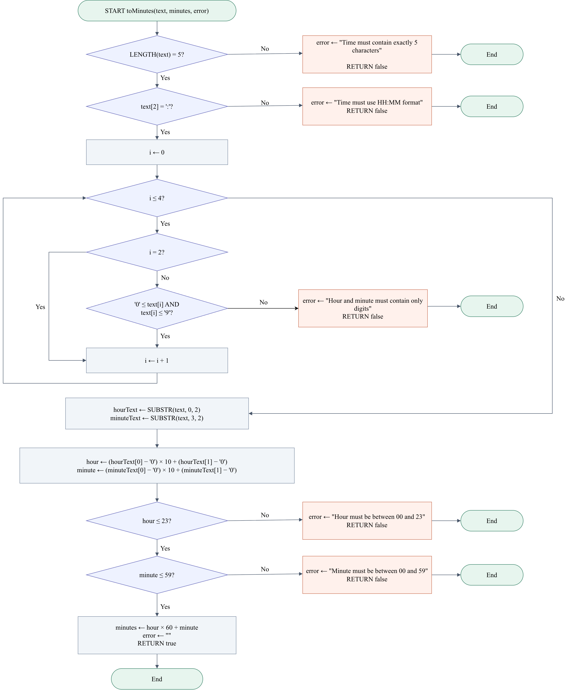

# T02 – Convert HH:MM to Minutes

- Assignee: Yến
- Reviewer: Triển

## 1. Function specification

- Proposed function signature:
```cpp
bool toMinutes(const string& text, int& minutes, string& error);
```

### Input
- `text`: the time string to validate. The required format is `HH:MM`
- Valid hours range from 00 to 23, and valid minutes range from 00 to 59
- Whitespace and extra characters are not allowed

## Output
- If valid: return `true`, set `minutes = hour * 60 + minute`,
  and set `error` to an empty string
- If invalid: return `false`, store the reason in `error`,
  and leave `minutes` unchanged. The caller must not use `minutes`
  when the function returns `false`

### Scope 
- Validate and convert a single time value
- Do not read CSV files or print warnings
- Do not check whether EXIT occurs before ENTER; this is handled in T07

## 2. Pseudocode 

Conventions:
- Character indices start at 0.
- SUBSTR(text, start, count) extracts count characters starting at index start.
- DIGIT_VALUE(c) = c - '0', used only after confirming that c is a digit.
- REFERENCE parameters allow the function to modify the caller's variables.

```text
FUNCTION toMinutes(text, REFERENCE minutes, REFERENCE error)

    IF LENGTH(text) != 5 THEN
        error ← "Time must contain exactly 5 characters"
        RETURN false
    END IF

    IF text[2] != ':' THEN
        error ← "Time must use HH:MM format"
        RETURN false
    END IF

      i ← 0

    WHILE i ≤ 4
        IF i = 2 THEN
        ELSE
            IF '0' ≤ text[i] AND text[i] ≤ '9' THEN
            ELSE
                error ← "Hour and minute must contain only digits"
                RETURN false
            END IF
        END IF

        i ← i + 1
    END WHILE

    hourText ← SUBSTR(text, 0, 2)
    minuteText ← SUBSTR(text, 3, 2)

    hour ← (hourText[0] - '0') * 10 + (hourText[1] - '0')
    minute ← (minuteText[0] - '0') * 10 + (minuteText[1] - '0')

    IF hour > 23 THEN
        error ← "Hour must be between 00 and 23"
        RETURN false
    END IF

    IF minute > 59 THEN
        error ← "Minute must be between 00 and 59"
        RETURN false
    END IF

    minutes ← hour * 60 + minute
    error ← ""
    RETURN true

END FUNCTION
```

## 3. Flowchart 

