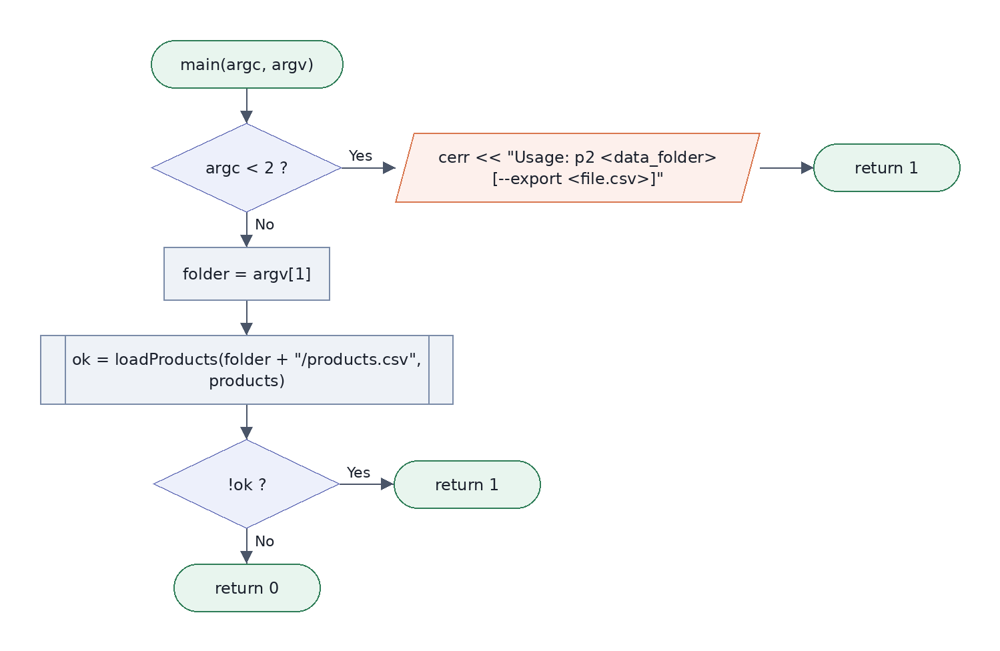
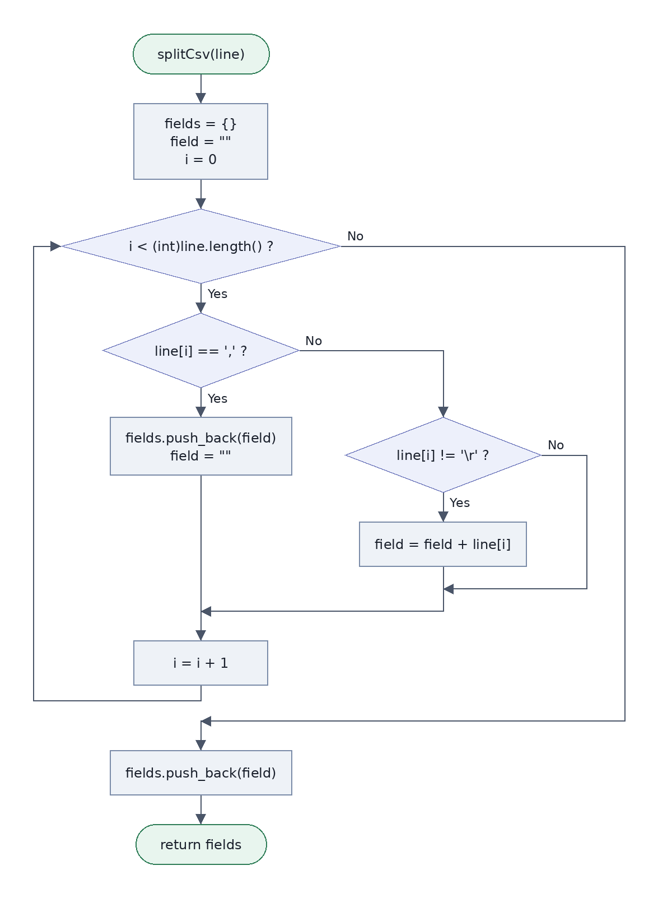
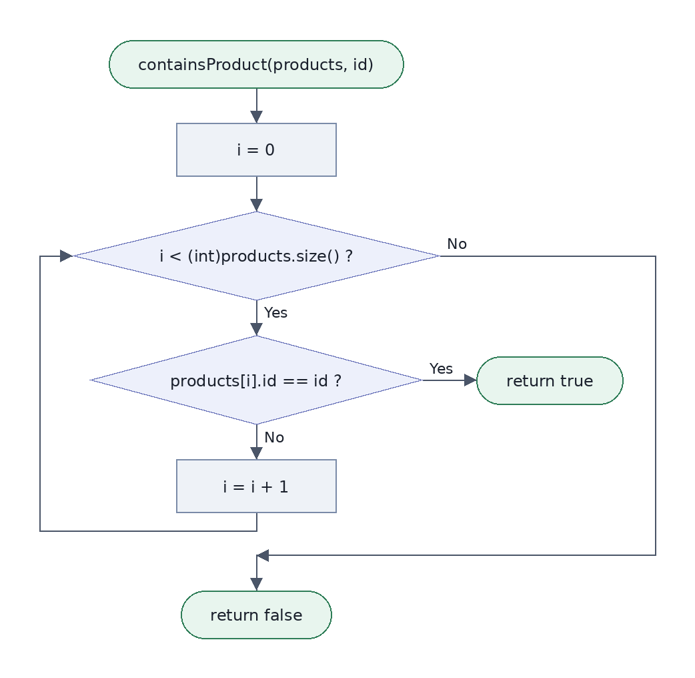
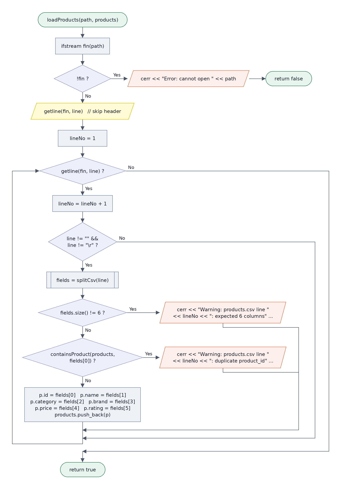

# T03 – Struct + splitCsv + containsProduct + loadProducts + main

Người làm: Triển. Reviewer: Trâm.

Input: thư mục dữ liệu (tham số dòng lệnh), tệp `products.csv`. Output: `vector<Product>` chứa các dòng hợp lệ; cảnh báo ra `cerr` kèm số dòng cho dòng sai số cột hoặc trùng `product_id`; báo lỗi và `return 1` khi thiếu tham số hoặc không mở được tệp.

Bẫy dữ liệu: `data/full/products.csv` dòng 43 (`P042,Broken Row,Sneakers,Puma`, 4 cột) và dòng 44 (`P005` trùng, tên khác) bị bỏ qua. `data/edge/empty` chỉ có header nên ra 0 sản phẩm, không lỗi. Dòng trống (kể cả dòng chỉ có `\r` ở cuối tệp) bị bỏ qua, không in cảnh báo. Ký tự `\r` của tệp tạo trên Windows bị bỏ trong `splitCsv`. Không mở `identity_links.csv`.

Ở T03, `main` mới chỉ đọc `products.csv`. Các task sau (T04, T05, T07, T08, T10, T11, T12, T13) bổ sung lời gọi hàm vào `main` và cập nhật flowchart `main` trong PR của mình.

## main

```cpp
int main(int argc, char* argv[])
```



Pseudocode:

```
FUNCTION main(argc, argv)
    IF argc < 2 THEN
        IO cerr << "Usage: p2 <data_folder>
        IO [--export <file.csv>]"
        RETURN 1
    END IF
    folder = argv[1]
    CALL ok = loadProducts(folder + "/products.csv",
    CALL products)
    IF !ok THEN
        RETURN 1
    END IF
    RETURN 0
END FUNCTION
```

## splitCsv

```cpp
vector<string> splitCsv(const string& line)
```



Pseudocode:

```
FUNCTION splitCsv(line)
    fields = {}
    field = ""
    i = 0
    WHILE i < (int)line.length() DO
        IF line[i] == ',' THEN
            fields.push_back(field)
            field = ""
        ELSE
            IF line[i] != '\r' THEN
                field = field + line[i]
            END IF
        END IF
        i = i + 1
    END WHILE
    fields.push_back(field)
    RETURN fields
END FUNCTION
```

## containsProduct

```cpp
bool containsProduct(const vector<Product>& products, const string& id)
```



Pseudocode:

```
FUNCTION containsProduct(products, id)
    i = 0
    WHILE i < (int)products.size() DO
        IF products[i].id == id THEN
            RETURN true
        END IF
        i = i + 1
    END WHILE
    RETURN false
END FUNCTION
```

## loadProducts

```cpp
bool loadProducts(const string& path, vector<Product>& products)
```



Pseudocode:

```
FUNCTION loadProducts(path, products)
    ifstream fin(path)
    IF !fin THEN
        IO cerr << "Error: cannot open " << path
        RETURN false
    END IF
    IO getline(fin, line)   // skip header
    lineNo = 1
    WHILE getline(fin, line) DO
        lineNo = lineNo + 1
        IF line != "" && line != "\r" THEN
            CALL fields = splitCsv(line)
            IF fields.size() != 6 THEN
                IO cerr << "Warning: products.csv line "
                IO << lineNo << ": expected 6 columns" ...
            ELSE IF containsProduct(products, fields[0]) THEN
                IO cerr << "Warning: products.csv line "
                IO << lineNo << ": duplicate product_id" ...
            ELSE
                p.id = fields[0]   p.name = fields[1]
                p.category = fields[2]   p.brand = fields[3]
                p.price = fields[4]   p.rating = fields[5]
                products.push_back(p)
            END IF
        END IF
    END WHILE
    RETURN true
END FUNCTION
```
