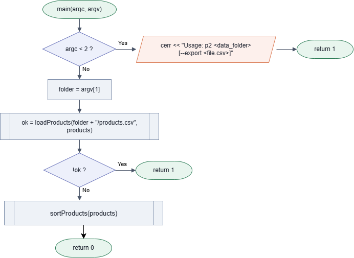
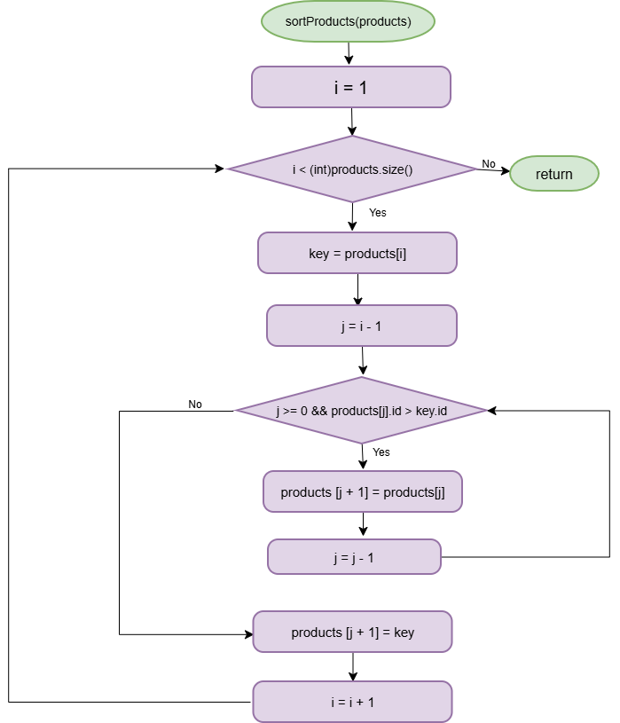
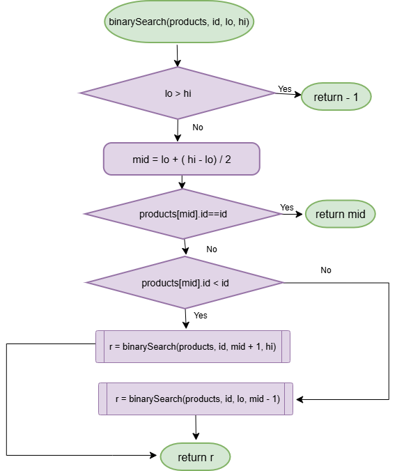
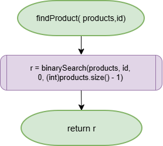

# T04 - sortProducts + binarySearch + findProduct

Người làm: Trâm. Reviewer: Kiên.

Input: 'vector<Product>' đã đọc từ 'products.csv', và 'products_id' cần tìm. Output: 'sortProducts' sắp xếp danh sách tăng dần theo 'id'; 'binarySearch' và 'findProduct' trả về vị trí (index) của sản phẩm, hoặc '-1' nếu không có.

Điều kiện: 'binarySearch' và 'findProduct' chỉ đúng khi danh sách đã được 'sortProducts'. Danh sách rỗng hoặc có 1 phần tử thì 'sortProducts' giữ nguyên; 'findProduct' trên danh sách rỗng trả về '-1'.

Ở T04, 'main' thêm lời gọi 'sortProducts(products)' ngay sau 'loadProducts'. Bản flowchart 'main' mới nhất nằm trong tệp này; tệp T03 giữ nguyên bản 'main' ở thời điểm T03.

## main

'''cpp
int main(int argc, char* argv[])
'''

Pseudocode:

'''
FUNCTION main(argc, argv)
    IF argc < 2 THEN 
        IO cerr << "Usage: p2 <data_folder> [--export <file.csv>]"
        RETURN 1
    END IF
    folder = argv[1]
    CALL ok = loadProducts(folder + "/products.csv", products)
    IF !ok THEN
        RETURN 1
    END IF
    CALL sortProducts(products)
    RETURN 0
END FUNCTION
'''            

## sortProducts

'''cpp
void sortProducts(vector<Product>& products)
'''

Pseudocode:

'''
FUNCTION sortProducts(products)
   i = 1
   WHILE i < (int)products.size() DO
       key = products[i]
       j = i - 1
       WHILE j >= 0 && products[j].id > key.id DO
           products[j+1] = products[j]
           j = j - 1
       END WHILE
       products[j + 1] = key
       i = i + 1
   END WHILE 
END FUNCTION
'''

## binarySearch

'''cpp
int binarySearch(const vector<Product>& products, const string& id, int lo, int hi)
'''

Pseudocode:

'''
FUNCTION binarySearch(products, id, lo, hi)
    IF lo > hi THEN
        RETURN -1
    END IF
    mid = lo + (hi - lo) / 2
    IF products[mid].id == id THEN
        RETURN mid
    END IF
    IF products[mid].id < id THEN
        CALL r = binarySearch(products, id, mid + 1, hi)
    ELSE
        CALL r = binarySearch(products, id, lo, mid - 1)
    END IF
    RETURN r
END FUNCTION
'''

## findProduct

'''cpp
int findProduct(const vector<Product>& products, const string& id)
'''

Pseudocode:

'''
FUNCTION findProduct(products, id)
    CALL r = binarySearch(products, id, 0, (int)products.size() -1)
    RETURN r
END FUNCTION
'''    