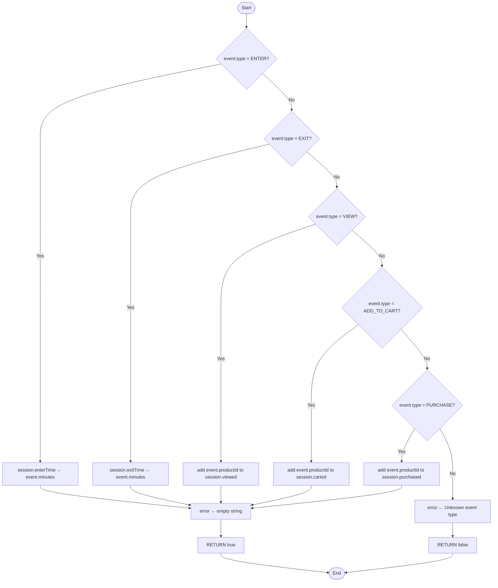

# T06 – Apply an Event to a Session (`applyEvent`)

- Assignee: Kiên
- Reviewer: Triển

## 1. Function specification

- Proposed function signature:
```cpp
bool applyEvent(Session& session, const Event& event, string& error);
```

### Input
- `session`: the session that the event belongs to (found by `findOrCreateSession()`)
- `event`: one customer event, with its time already converted to minutes

### Output
- If the event type is known: update `session` according to the table below,
  set `error` to an empty string, and return `true`
- If the event type is unknown: return `false`, store the reason in `error`,
  and leave `session` unchanged. The caller decides what to do with the error

| Event type    | Update to `session`                          |
| ------------- | -------------------------------------------- |
| `ENTER`       | `enterTime ← event.minutes`                  |
| `EXIT`        | `exitTime ← event.minutes`                   |
| `VIEW`        | add `event.productId` to `viewed`            |
| `ADD_TO_CART` | add `event.productId` to `carted`            |
| `PURCHASE`    | add `event.productId` to `purchased`         |

### Scope
- Only update one session with one event
- Do not find or create the session; this is done by `findOrCreateSession()`
- Do not read CSV files or print warnings; the caller prints the error
- Do not validate the event line; this is handled in T05
- Do not compute dwell time; this is handled in T07
- Do not update interest scores; this is handled in T09

## 2. Pseudocode

Conventions:
- REFERENCE parameters allow the function to modify the caller's variables.
- `event.minutes` is the event time converted by `toMinutes()` (T02).

```text
FUNCTION applyEvent(REFERENCE session, event, REFERENCE error)

    IF event.type = "ENTER" THEN
        session.enterTime ← event.minutes
    ELSE IF event.type = "EXIT" THEN
        session.exitTime ← event.minutes
    ELSE IF event.type = "VIEW" THEN
        add event.productId to session.viewed
    ELSE IF event.type = "ADD_TO_CART" THEN
        add event.productId to session.carted
    ELSE IF event.type = "PURCHASE" THEN
        add event.productId to session.purchased
    ELSE
        error ← "Unknown event type"
        RETURN false
    END IF

    error ← ""
    RETURN true

END FUNCTION
```

## 3. Flowchart


