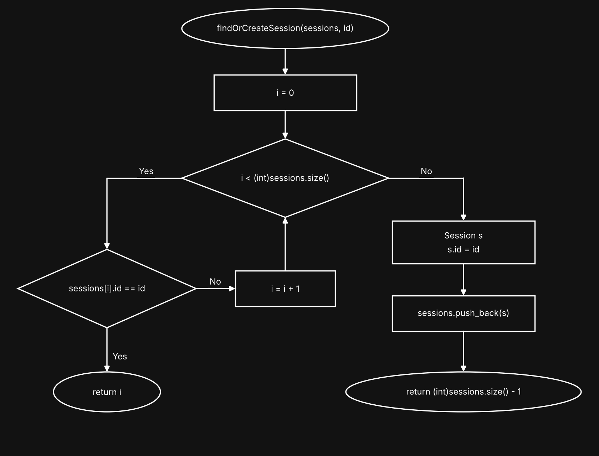
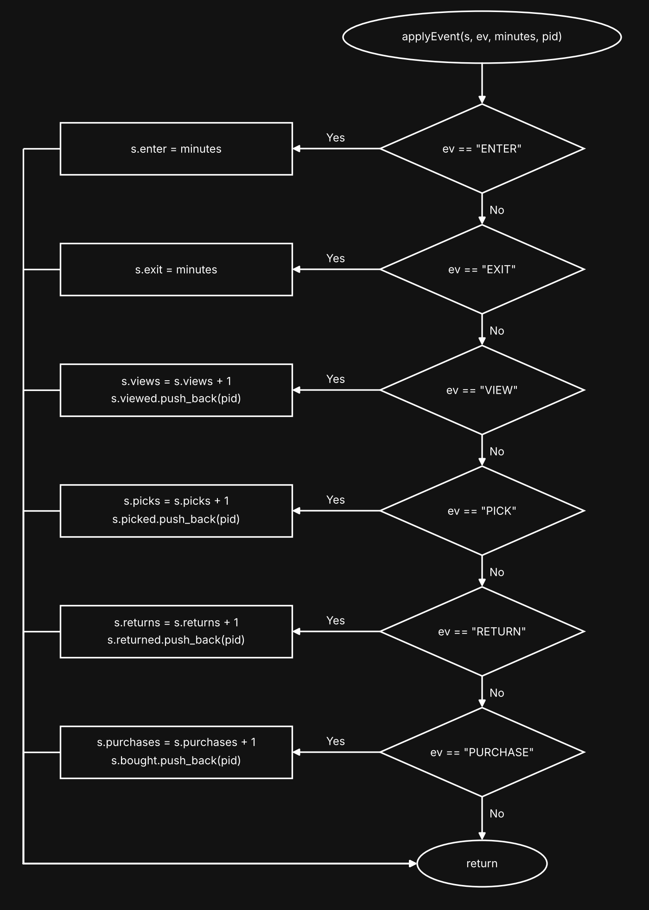

# T06 – findOrCreateSession + applyEvent

Người làm: Kiên. Reviewer: Triển.

Input: `vector<Session>` các phiên đã tạo, `id` của phiên cần tìm (lấy từ sự kiện đang xử lý), và một sự kiện đã hợp lệ gồm loại sự kiện `ev`, thời gian `minutes` (đã đổi bằng `toMinutes`) và `pid`. Output: `findOrCreateSession` trả về vị trí (index) của phiên có `id` đó, nếu chưa có thì thêm một `Session` mặc định vào cuối `sessions` rồi trả về index của nó. `applyEvent` cập nhật phiên `s` theo loại sự kiện.

Điều kiện: `findOrCreateSession` luôn trả về index hợp lệ vì `sessions` là `vector` tự mở rộng. Hàm trả về index chứ không trả tham chiếu, vì `push_back` có thể làm vector cấp phát lại bộ nhớ. Phiên mới có `enter = -1`, `exit = -1`, các bộ đếm bằng 0 và các danh sách rỗng (giá trị mặc định của struct `Session`). `applyEvent` giả định sự kiện đã được T05 kiểm tra; loại sự kiện không nằm trong 6 loại bên dưới thì không làm gì. `ENTER` hoặc `EXIT` xuất hiện nhiều lần trong một phiên thì lần sau ghi đè lần trước. Không tính thời gian ở lại (T07), không cập nhật `Totals` (T08) và `Interest` (T09).

Cách `loadEvents` (T05) dùng hai hàm: `idx = findOrCreateSession(sessions, id)` rồi `applyEvent(sessions[idx], ev, minutes, pid)`.

| `ev`       | Cập nhật `s`                                                    |
| ---------- | --------------------------------------------------------------- |
| `ENTER`    | `enter = minutes`                                               |
| `EXIT`     | `exit = minutes`                                                |
| `VIEW`     | `views = views + 1`, thêm `pid` vào `viewed`                    |
| `PICK`     | `picks = picks + 1`, thêm `pid` vào `picked`                    |
| `RETURN`   | `returns = returns + 1`, thêm `pid` vào `returned`              |
| `PURCHASE` | `purchases = purchases + 1`, thêm `pid` vào `bought`            |

## findOrCreateSession

```cpp
int findOrCreateSession(vector<Session>& sessions, const string& id)
```



Pseudocode:

```
FUNCTION findOrCreateSession(sessions, id)
    i = 0
    WHILE i < (int)sessions.size() DO
        IF sessions[i].id == id THEN
            RETURN i
        END IF
        i = i + 1
    END WHILE
    Session s                  // giá trị mặc định
    s.id = id
    sessions.push_back(s)
    RETURN (int)sessions.size() - 1
END FUNCTION
```

## applyEvent

```cpp
void applyEvent(Session& s, const string& ev, int minutes, const string& pid)
```



Pseudocode:

```
FUNCTION applyEvent(s, ev, minutes, pid)
    IF ev == "ENTER" THEN
        s.enter = minutes
    ELSE IF ev == "EXIT" THEN
        s.exit = minutes
    ELSE IF ev == "VIEW" THEN
        s.views = s.views + 1
        s.viewed.push_back(pid)
    ELSE IF ev == "PICK" THEN
        s.picks = s.picks + 1
        s.picked.push_back(pid)
    ELSE IF ev == "RETURN" THEN
        s.returns = s.returns + 1
        s.returned.push_back(pid)
    ELSE IF ev == "PURCHASE" THEN
        s.purchases = s.purchases + 1
        s.bought.push_back(pid)
    END IF
END FUNCTION
```
